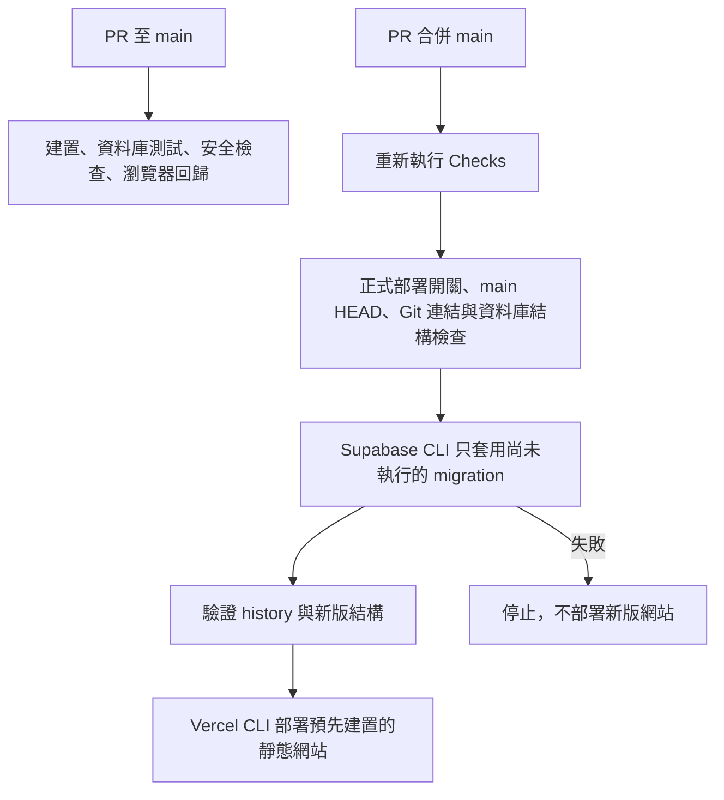

# GitHub Actions、Supabase 與 Vercel 部署

這份設定只在 PR 中建立流程，不代表已啟用、已操作正式資料庫或已部署。啟用前需完成下列一次性設定；不需要把任何金鑰貼到對話中。

## 部署方式



- PR workflow 不讀正式 Secrets；使用獨立 PostgreSQL 17 service、本機 PGlite 及模擬 Auth，不接正式 Supabase。
- 安全檢查包含正式與開發依賴的 high／critical audit、部署工具 audit、常見憑證簽章掃描及 migration 不可變檢查。官方 Vercel Linux x64 native CLI 以獨立鎖檔安裝，只執行靜態 prebuilt 部署，不帶入框架 build fallback 的大型可選依賴。Supabase CLI、Actions 與部署工具均固定版本／commit；升級亦需 PR。
- 正式 workflow 只接受 `main` 的 push 或手動重試，並確認執行 commit 仍是 main HEAD。請用 main 分支保護禁止直接推送，確保 push 都來自已審查 PR。
- `PRODUCTION_AUTOMATION_ENABLED` 預設未設定，正式自動部署不會啟動。手動模式也限定 main，且必須填完整 main commit SHA。
- 同一個 GitHub concurrency group 不取消執行中的部署；跨同步／部署模式共用 PostgreSQL session advisory lock `(178403, 1)`。其他自建部署工具也必須遵守同一把鎖；這不能阻止有管理權限的人直接繞過流程改 SQL。
- 不使用 db reset、include-all、include-roles 或 include-seed；舊 migration 不可修改、刪除或重排。新 SQL 需獨立新檔案。

## 1. 合併此 PR 前，先中斷 Vercel Git 自動部署

**必須先完成，才能避免舊 Git 自動部署搶先發布。**

1. 在目前 Vercel 專案的 Settings → Git，Disconnect Git Repository。不要刪除 Vercel 專案、網域或現有 deployment。
2. 在 Deployments 取消所有尚未完成的 Git 自動部署，包含 queued／building／ready 待 promotion 的作業。保留現在線上的版本。
3. 停用其他會部署此正式專案的 workflow、deploy hook 或自動 promotion。既有已發出的部署也要確認結束或取消。
4. repo 的 `vercel.json` 另設 `git.deploymentEnabled=false`，避免後續意外重接後由 Git 建新部署；**真正的正式前置條件仍是 API 回報專案已無 Git link**。只填「我已停用」旗標不會通過檢查。

Actions 發布前後段都會讀 Vercel Project／Deployments API：專案／帳號 ID 不符、仍有 Git link，或尚有 queued／initializing／building 的正式部署，一律停止，且初次檢查在任何 migration 前。這次 PR 不會替你改動 Vercel 設定。停用 Git 也會停止 Git Preview；PR 改由 Actions 驗證，不會自動部署預覽或接觸正式資料。

## 2. GitHub 設定

在 repository Settings → Environments 建立：

- `production`：Deployment branches 限定 main。一般部署不設 Required reviewers，才能在合併後自動執行；若自行加上 reviewer，每次部署都會等待批准。
- `production-migration-review`：Deployment branches 限定 main，**設定 Required reviewers**，作為高風險 migration 的額外審查。這個 environment 不存 Secrets。多人維護時可開啟 Prevent self-review；若只有自己維護，需允許自己完成這次獨立確認，或先加入另一位有權限的 reviewer。

此 repo 目前為公開 repository，可使用 GitHub Free 的公開庫 Actions 與 environment 保護。若日後改成私人庫，請先確認當時免費方案是否仍支援所需保護；不要為了流程自動升級付費方案。未設定 Required reviewers 時，GitHub 不會憑 environment 名稱強制人工審查。

在 Rules／Branches 保護 main：要求透過 PR、至少一次審查、通過 **Build, database and security** check，啟用 Code Owners 審查，禁止 force push 與刪除分支。reusable workflow 的 check 名稱在 Actions 首次執行後選取實際顯示名稱。`.github/CODEOWNERS` 覆蓋 SQL、部署程式、workflow、Vercel 設定及套件鎖檔；有繞過權限的人仍需遵守審查流程。

## 3. GitHub Secrets 清單

在 **Settings → Environments → production → Environment secrets** 設定以下值，不能填到 repo、workflow 字面值或聊天：

| Secret | 取得／用途 |
| --- | --- |
| `SUPABASE_DB_URL` | Dashboard → Connect 的正式 PostgreSQL URI，資料庫 postgres，管理角色 postgres，包含百分比編碼的資料庫密碼。優先用 **Session pooler、5432** 的 URI。 |
| `SUPABASE_PROJECT_REF` | 正式專案的 20 位小寫 project ref，用來交叉核對 URI 與前端 URL。 |
| `SUPABASE_DB_CA_CERT` | 若系統信任鏈無法驗證 Supabase 憑證，從官方 Dashboard 取得資料庫 CA certificate 的完整 PEM。可先設定以避免第一次連線失敗；不得關閉憑證驗證。 |
| `VERCEL_TOKEN` | Vercel Account Settings → Tokens，使用有權限部署此專案的最小可用帳號／team 範圍，定期輪替。 |
| `VERCEL_ORG_ID` | 現有專案的 team／account ID，需與 Project API 的 accountId 相同。可從既有 `.vercel/project.json` 查看；不要把整個 .vercel 目錄提交。 |
| `VERCEL_PROJECT_ID` | Vercel Project Settings 的 Project ID，或既有 `.vercel/project.json`。 |
| `VITE_SUPABASE_URL` | 正式 Supabase 專案公開 URL，必須是 `https://<project-ref>.supabase.co`。 |
| `VITE_SUPABASE_PUBLISHABLE_KEY` | 同專案的 publishable key 或舊 anon JWT；絕對不能填 service_role／secret key。 |

`GITHUB_TOKEN` 由 Actions 自動提供且只授權 contents:read，不需要另建 GitHub PAT。因為 CLI 使用明確的 `--db-url`，**不需要 SUPABASE_ACCESS_TOKEN，也不需要 service_role key**。

Vite 公開 URL／key 會進瀏覽器 bundle；它們即使存成 Secrets 也不是瀏覽器端秘密，資料隔離仍由 Auth、RLS 及 RPC 控制。資料庫與 Vercel 憑證只傳給部署步驟，不傳入 Vite build。Production 使用 GitHub Secrets 中的公開設定建置，因此不依賴 Vercel build environment，也不會拉取 Vercel 上的其他環境變數。

## 4. Supabase 連線設定

- 保留現有 Supabase 專案、資料、帳號、RLS 及登入 URL 設定，不建立新專案、不 reset。
- GitHub hosted runner 常需要 IPv4；可用現有免費 Session pooler 的 5432 port，username 形式為 postgres.<project-ref>。不要使用 6543 Transaction pooler，session lock 不適用。
- 若使用 direct URI，hostname 必須是 db.<project-ref>.supabase.co，user postgres，5432，且 runner 須能連線。不會自動購買 IPv4 add-on。
- 若既有網路限制阻擋 runner，先由管理者決定可接受的連線方式；流程不會自行關閉限制或購買固定 IP。
- Node 驗證憑證；CLI 同時使用 verify-full URL 與 PGSSLMODE／PGSSLROOTCERT。未信任或主機名稱不符的憑證會停止流程，不能改成不驗證。
- `supabase/config.toml` 的 major_version=17 是本機測試預設，不會替正式 Supabase 升級 PostgreSQL。若正式版本產生不同 catalog 表示而驗證失敗，先檢查差異，不要略過驗證或 repair。

## 5. 一次性同步已手動執行的 migration history

若 verify-history 回報 functions／functionGrants 差異，先依 [函式唯讀診斷](function-diagnostics.md) 取得逐項事實；不要直接 repair、重跑 SQL 或將差異視為平台預設而忽略。

已驗證的 CRLF／LF 與單一官方 RLS 模板依 [精確比較規則](function-comparison-plan.md) 處理。來源、完整 ACL、metadata 或 event trigger 綁定不符仍會停止，沒有全面忽略額外函式。

正式庫已手動套用這兩份 SQL：

- `202611060001_mvp.sql`
- `202611210001_permanent_delete_unknown_cards.sql`

**不要重新執行上述 SQL。** Supabase CLI 只依 history 判斷是否已執行；因此必須先補登已確認的版本，不能直接 db push。

1. 合併本 PR 前完成 Vercel Git 中斷與 Secrets 設定；`PRODUCTION_AUTOMATION_ENABLED` 先保持未設定／false。合併本 PR 後 Production 的 checks 會跑，正式 job 預設跳過。
2. GitHub → Actions → **Production → Run workflow**，選 main，mode 選 **verify-history**。expected_commit 填當時 main 完整 40 位 SHA；approval 留空。
3. 此模式只讀 catalogs 與 migration history；用兩份不可變 migration 在本機 PGlite 建立參考結構，比對 public／app_private 的非 extension 物件：欄位、預設值、主外鍵／check／unique、索引、RLS／policy、client 權限與角色危險旗標、trigger、函式內容／owner／security definer／search_path。它不讀取正式卡片、操作快照或帳號內容，不會寫入 history，也不會部署。
4. 檢查成功的 Job Summary，記下 **Verified plan** 的 SHA256；確認顯示的待補登版本正是上述兩份或其中尚未登錄的一份。
5. 再 Run workflow，仍選 main，mode **sync-history**，填相同 expected_commit，approval 填上一步的完整 Verified plan。若 main 已變動，先重跑 verify-history，不能使用舊 fingerprint。
6. 系統重新驗證結構，在同一把鎖內只對缺少的已確認版本執行 `supabase migration repair <versions> --status applied`，然後重新驗證。**不會執行 db push、不會重播 SQL、不會部署網站**。已完整登錄時為無變更驗證。
7. 若發現未知版本、結構／函式內容不同、舊 migration 被改過或順序不符，流程停止。不要直接 repair 當作解法；先釐清實際結構與原始 SQL 的差異，經審查以獨立修正方案處理。驗證採嚴格比較；即使只是自行改過函式格式，也可能需要人工調查。
8. 同步成功後，在 Settings → Secrets and variables → Actions → **Variables** 新增 repository variable `PRODUCTION_AUTOMATION_ENABLED=true`。再手動以 mode **deploy**、目前 main SHA 執行第一次部署。此時沒有 pending migration，舊 SQL 會跳過。

未完成 baseline history 時，即使先打開開關，正式 deploy 也會拒絕執行，不會把兩份舊 SQL 當成待套用 migration。

## 6. 日常與高風險變更

一般合併 main 後自動重新跑 checks、確認目標與已套用結構，dry-run 後僅 db push 尚未登錄的後續 migration；成功且 history／新結構符合預期，才由 Vercel CLI --prebuilt --prod 發布。沒有 pending SQL 時直接略過 SQL 執行。

自動 SQL allowlist 刻意很窄：簡單、已明確 schema-qualified 的欄位索引，以及無 default／NOT NULL 的基本型別新增欄位。其餘變更一律要求額外審查，包含新表、改欄位、DML 回填、權限、policy、trigger、函式替換、動態 SQL。它是保守的流程門檻，不是完整 SQL 安全證明；Code Owners 必須審查 SQL 真正影響。

含上述變更時，自動部署會先顯示 plan fingerprint 並停止，**不套用 pending SQL、不發布新版網站**。維護者檢查 SQL、資料保留／回復方案與前後相容性後，手動選 **deploy-reviewed**，填 main SHA 與該計畫 fingerprint，再由 `production-migration-review` environment reviewer 批准。進正式 job 後再次核對 commit／計畫／結構；變動即停止。DROP DATABASE／DROP SCHEMA／DROP ROLE／ALTER SYSTEM 及平台資料的明顯重置指令即使經 review 也不支援。

不要透過關閉檢查、修改 baseline hash 或改舊 SQL 讓部署通過。部署檔案與 SQL 的修改本身都需要 PR 審查。

## 7. 失敗、重試與費用

- migration 失敗：新版網站不部署，現有網站仍在線。多份 migration 可能已有前面幾份成功，不能假設全部回滾。新 migration 應自行使用合適交易、保留資料並與舊網站相容；外部副作用／非交易 DDL 需另外規劃。
- migration 成功、Vercel 失敗：資料庫可能已更新，但不會自動倒退或重置。若只是回應中斷，先在 Vercel 確認是否已發布；CLI 失敗不代表遠端一定沒有部署。修好問題後以 mode deploy 重試最新 main；已登錄 SQL 不再執行，未完成的正式部署會被前置檢查攔住。必要時依已審查的獨立新 migration 向前修正。
- workflow 已過期：main HEAD 改變會停止舊工作，交給最新 main run。GitHub concurrency 不保證佇列 FIFO，且可能只保留最新 pending run；最新版本會套用所有尚未套用的 migration。
- 若人工取消工作或失去資料庫鎖連線，停止／終止 CLI，不盲目重跑。確認沒有舊程序仍執行，再用 history 與結構檢查決定後續；其他部署工具也必須使用同一鎖。
- CLI 原始輸出與資料庫錯誤可能含連線或資料內容，因此部署步驟不直接輸出；只有版本、fingerprint 與成功部署 URL。不要用 --debug、set -x 或印出環境變數；不要上傳 .env、.vercel、資料庫 dump 作為 Actions artifact。
- 本流程不新增付費服務、Supabase branching、PITR、專用 runner、Vercel Turbo build 或付費安全產品。仍受現有免費方案的用量／適用條件限制；額度不足時停止，由使用者決定，不自動升級。

## 本機驗證

```bash
npm ci --ignore-scripts
npm run security:check
npm audit --audit-level=high
npm audit --prefix scripts/deploy/tools --audit-level=high
npm test
npm run test:deployment
npm run build
```

沒有 CI_DATABASE_URL 時，只跑部署單元測試並明示略過真 PostgreSQL／CLI 測試。完整整合測試需 PATH 有固定的 Supabase CLI 2.67.1，以及只含測試資料的本機 PostgreSQL service；將 CI_DATABASE_URL 設為 **loopback、資料庫 ci_test** 的 URI，再設 REQUIRE_CLI_TESTS=true。測試只在該本機 service 建立／移除隨機測試資料庫，拒絕遠端 URI；不可以改成正式憑證。GitHub workflow 已提供這個免費臨時 service。Linux x64 若也要驗證原生 Vercel 工具安裝，可執行 npm ci --prefix scripts/deploy/tools --ignore-scripts；其他平台不需安裝此獨立工具，仍可開發／建置網站。

本機測試能驗證修補 history 不重播、pending-only、失敗順序、鎖與資料保留；不能代替真正的 GitHub hosted runner、Supabase TLS／pooler 或 Vercel 帳號權限驗收。這次 PR 不會執行上述正式驗收。
